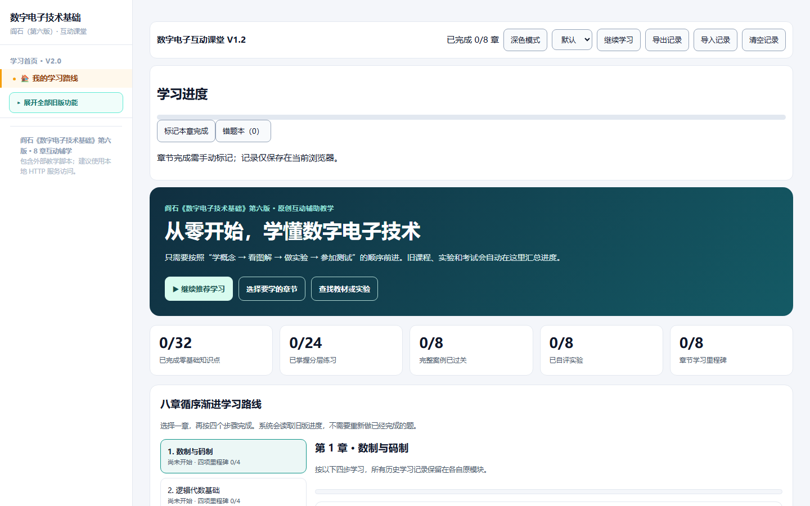
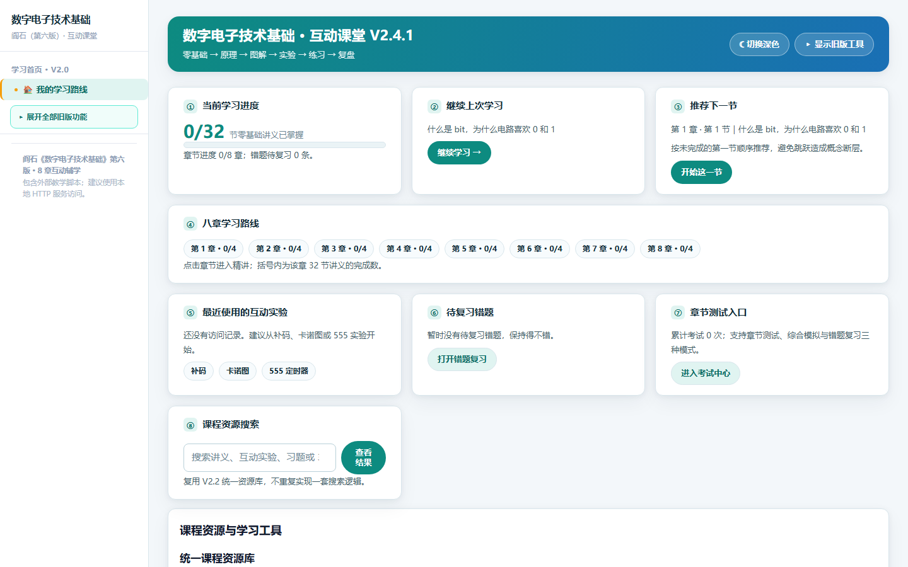
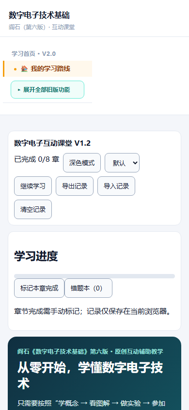
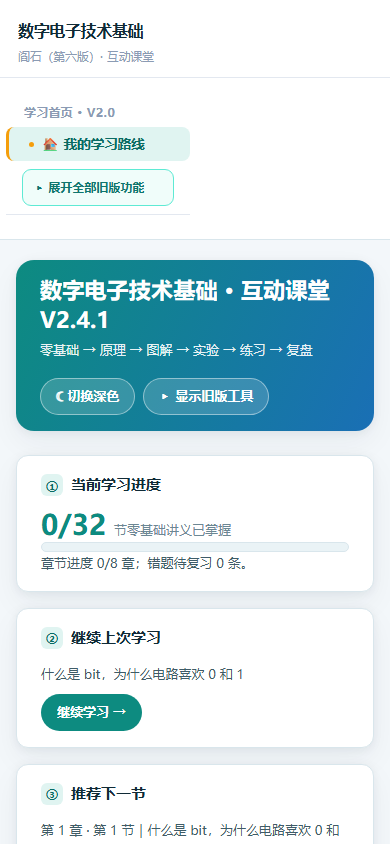
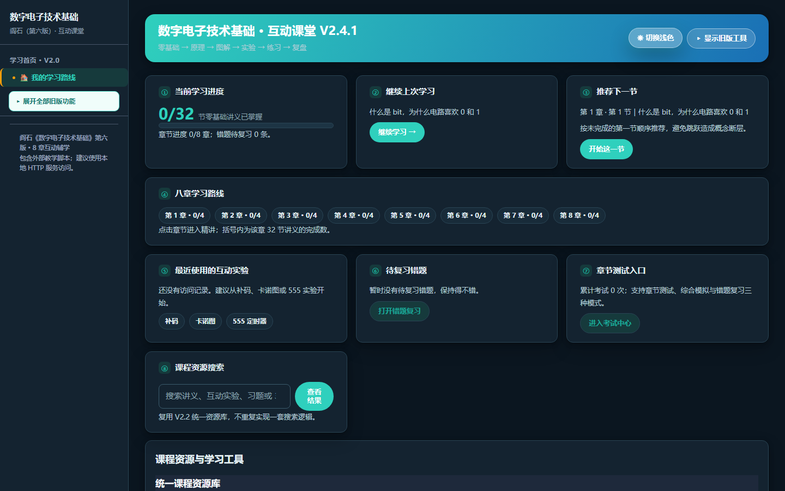
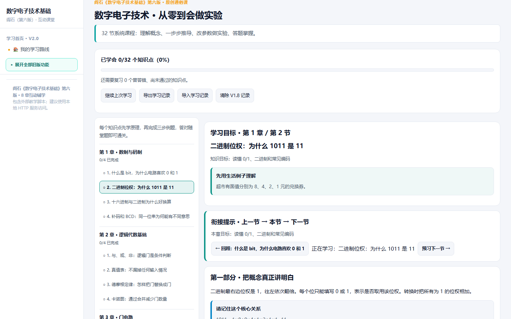
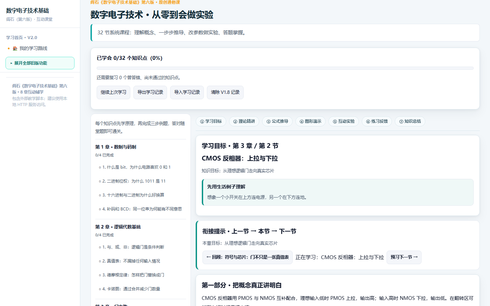
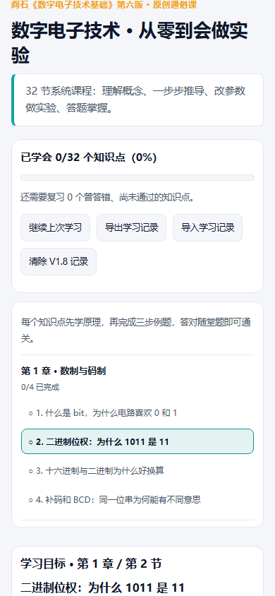
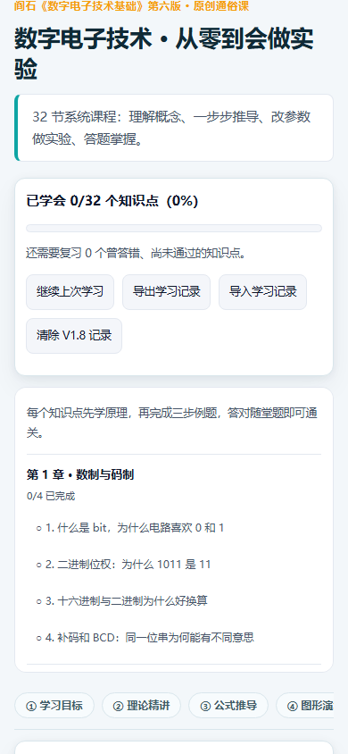
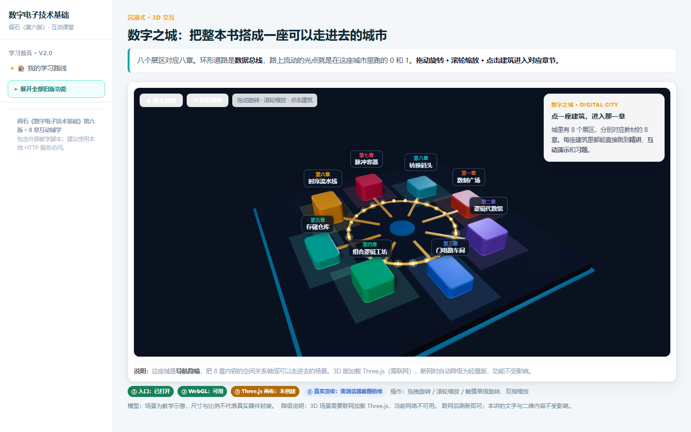

# V2.4.1 界面改进前后对比截图

> 截图由 Playwright + Chromium 在 `http://127.0.0.1:8001/` 真实渲染采集。
> 「改版前」为基线提交 `104b940` 的界面；「改版后」为 V2.4.1 最终界面。
> 两组截图使用相同视口尺寸（桌面 1440×900、手机 390×844），可直接对照。

## 1. 学习首页 · 桌面 1440×900

| 改版前 | 改版后 |
|---|---|
|  |  |

**变化**：改版前顶部依次堆叠 V1.1 工具栏、V1.1 进度面板、V2.0 深色宣传横幅、V2.0 KPI 条、八章路线、资源库共 6 套入口；改版后收拢为一张 8 卡片仪表盘（进度 / 路线 / 继续学习 / 推荐 / 最近实验 / 错题 / 测试 / 搜索），重复旧版入口默认收起，保留「显示旧版工具」开关恢复。配色统一为蓝绿设计系统，卡片圆角与阴影一致。

## 2. 学习首页 · 手机 390×844

| 改版前 | 改版后 |
|---|---|
|  |  |

**变化**：窄屏卡片自动单列，顶部横幅与操作按钮换行不溢出；四种视口（375/390/768/1440）实测横向溢出均为 0。

## 3. 深色主题（新增）

主题状态复用 V1.1 已有的 `digital-course-v1.1` 存档，不新增键、不清空历史记录；刷新后保持。

## 4. 课程讲义阅读页 · 桌面 / 手机

| 视口 | 改版前 | 改版后 |
|---|---|---|
| 桌面 1440×900 |  |  |
| 手机 390×844 |  |  |

**变化**：新增七段学习路径导航（学习目标 → 理论精讲 → 公式推导 → 图形演示 → 互动实验 → 练习反馈 → 知识总结）、「先预测实验结果」交互、知识总结与复习建议；公式与 SVG 在窄屏自适应、允许换行，不产生横向滚动。

## 5. 3D 场景（真实渲染截图）

该截图在本地 WebGL 与 Three.js CDN 均可用时采集；CI 若不具备 GPU 或 CDN 被拦截，对应渲染测试会显式跳过，详见交付报告。
