# V2.5.0 界面改进前后对比

所有截图由 Playwright + Chromium 在 `http://127.0.0.1:8001/`（改版后）与 `http://127.0.0.1:8003/`（由 Git 基线 `06aa9ab` 还原的 V2.4.1 站点，改版前）真实渲染采集，视口 1440×900。

## 一、新增：可视化电路实验室与波形分析仪

V2.4.1 没有这两块工具，因此只有「改版后」截图。

| 电路实验室（半加器案例） | 波形分析仪 |
|---|---|
| 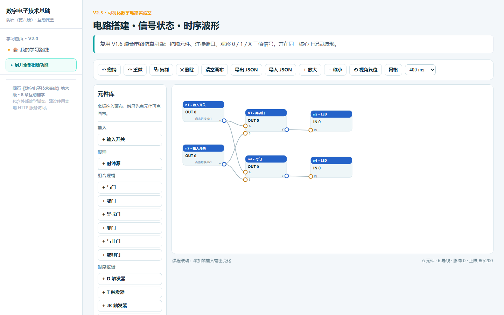 | 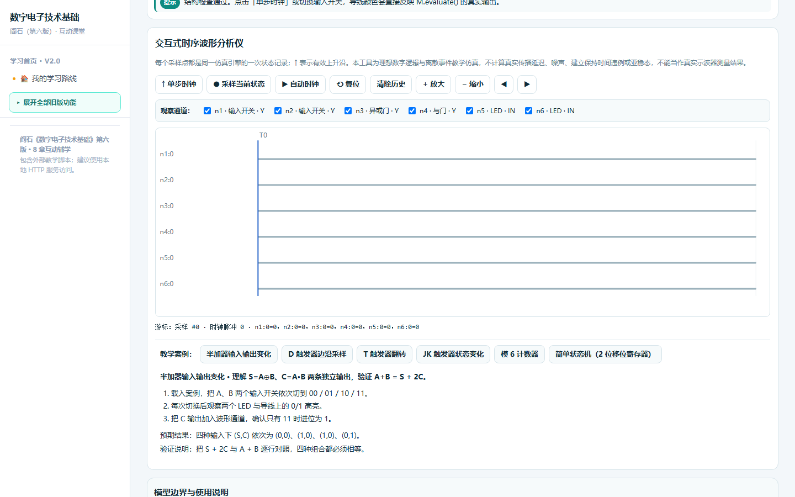 |

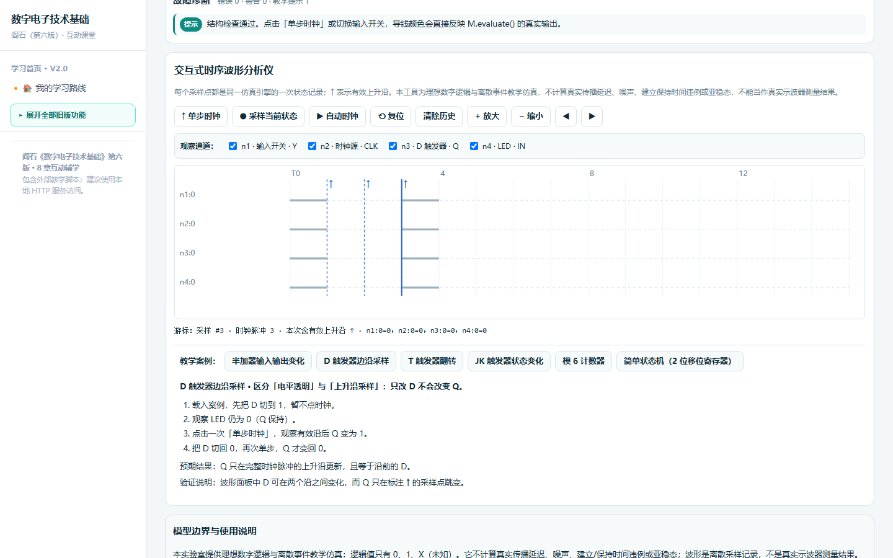

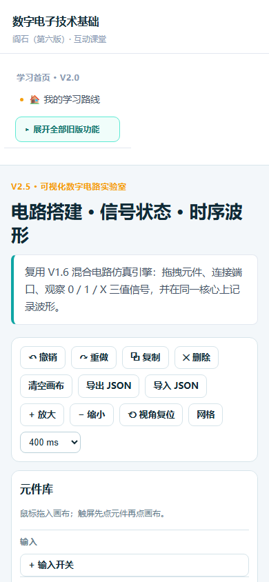

## 二、五个 3D 场景改版前后

改版后每个场景底部新增统一相机控制条（重置视角 / 自动环绕 / 暂停渲染 / 缩放 / 实时球坐标状态）；离开场景会暂停 RAF 循环，全站共用一个尺寸观察器，并提供 WebGL 上下文丢失与 CDN 失败的中文降级说明。**场景内的教学模型、灯光与几何体未改写**。

| 场景 | 改版前（V2.4.1） | 改版后（V2.5.0） |
|---|---|---|
| w1 数字之城 | 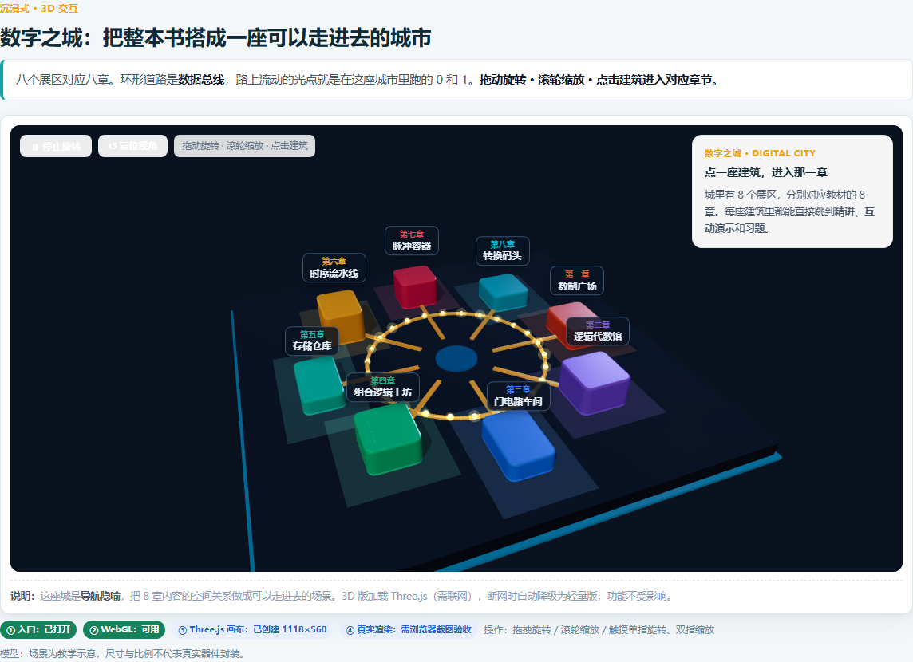 | 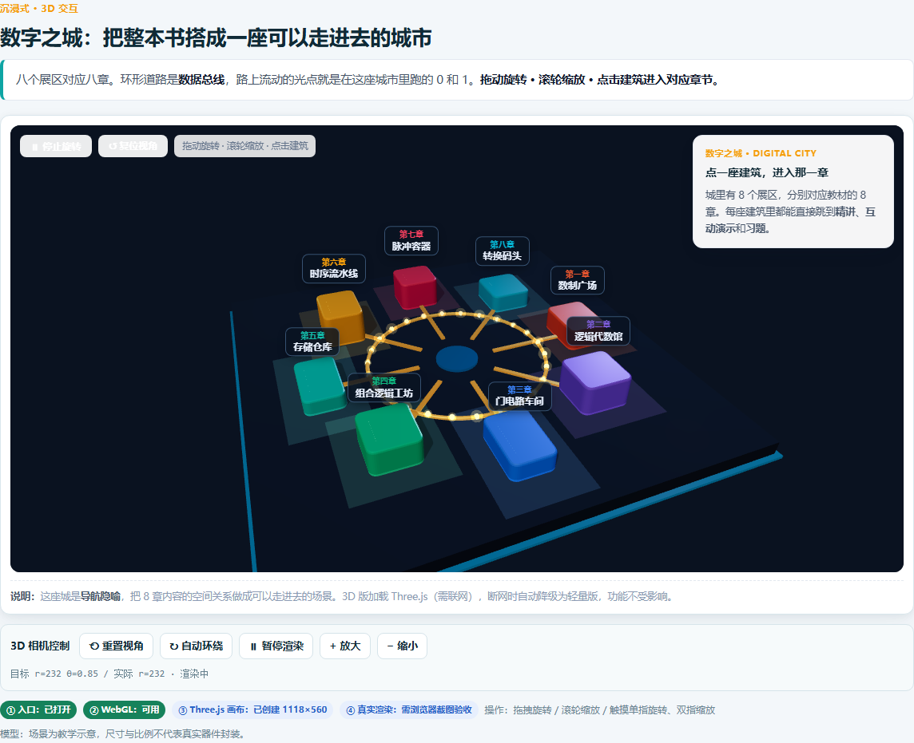 |
| w2 时序流水线 | 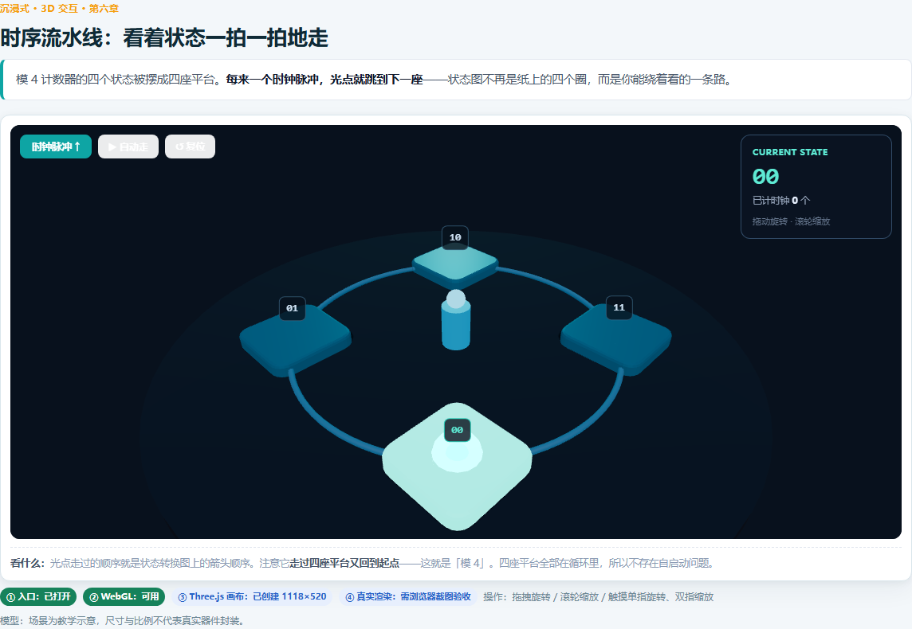 | 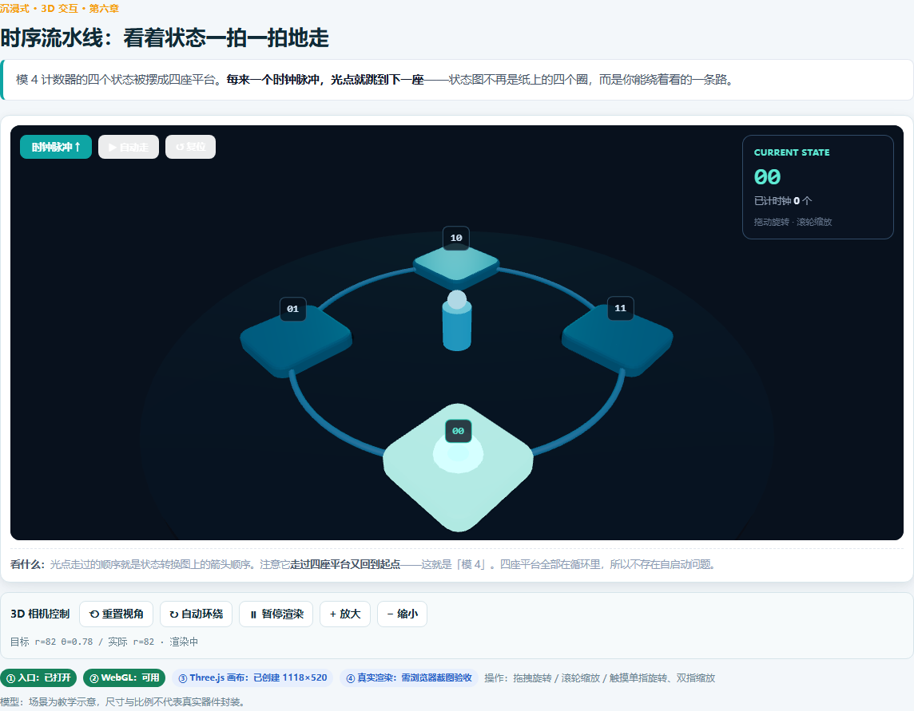 |
| w3 CMOS 剖面 | 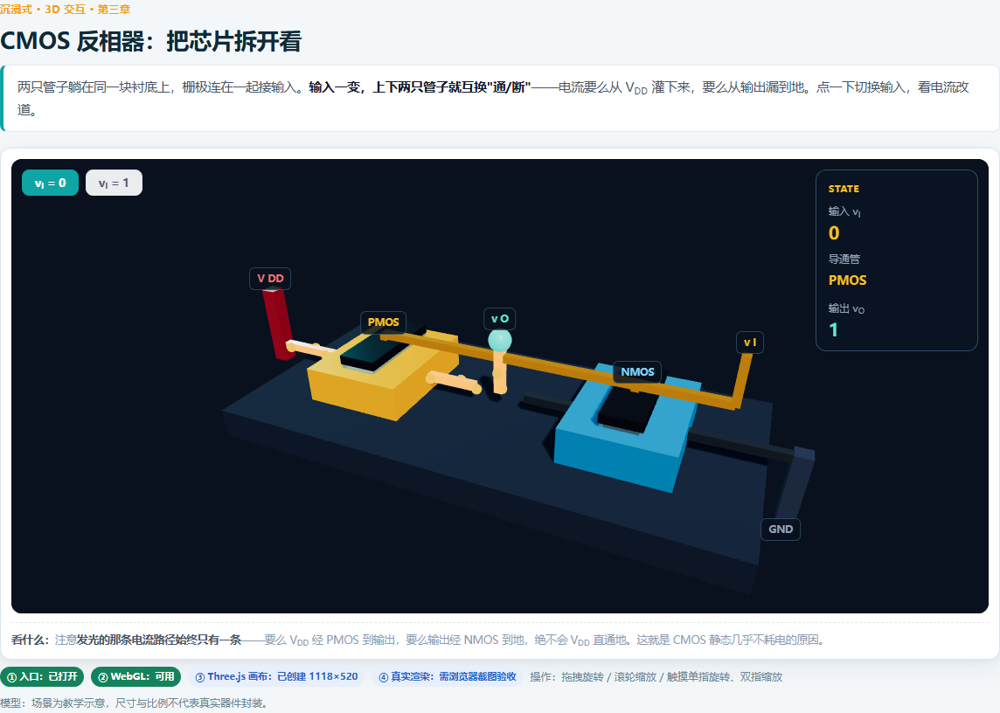 | 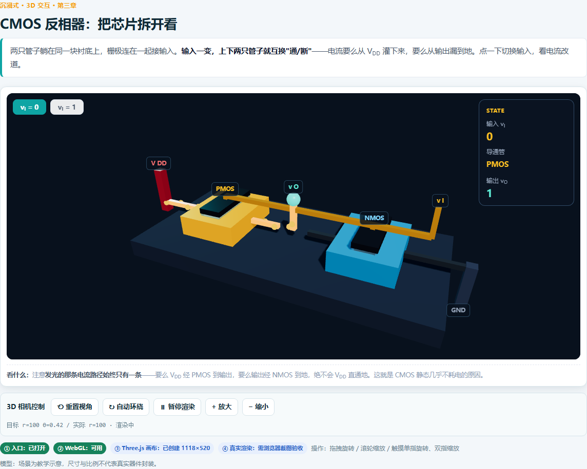 |
| w4 555 振荡器 | 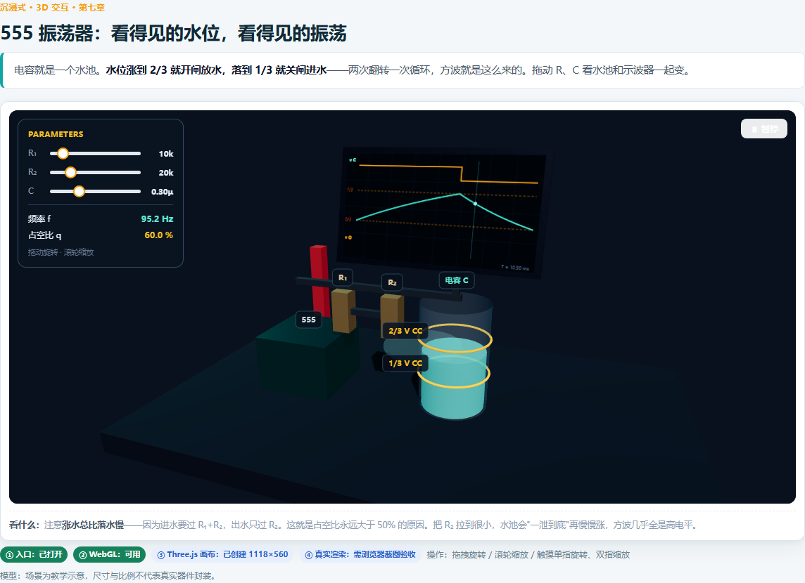 | 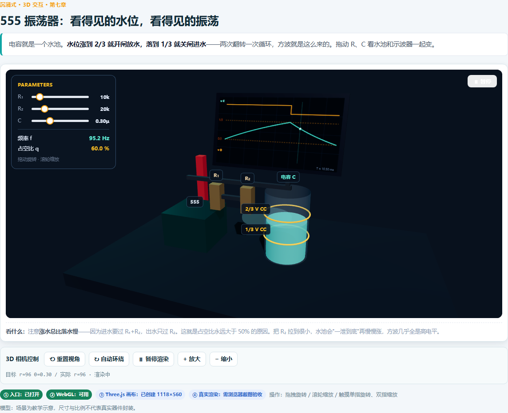 |
| w5 R-2R 梯子 | 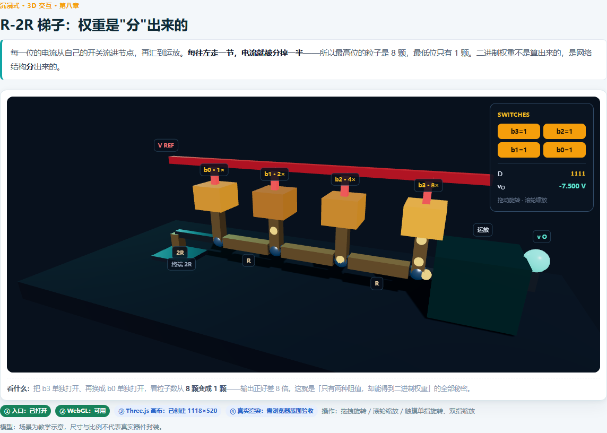 | 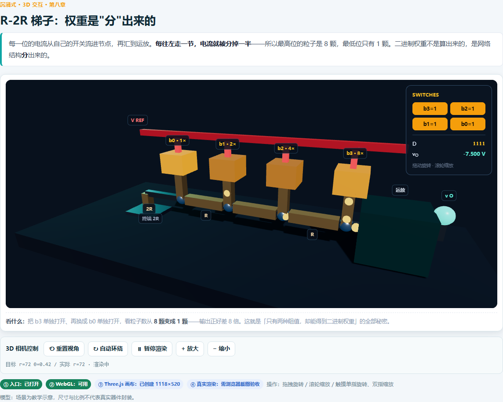 |

> 说明：本次 3D 改进集中在交互与生命周期，视觉模型本身的变化仅限控制条与状态显示；未做灯光/材质/模型比例重制（见更新日志「已知问题」）。
